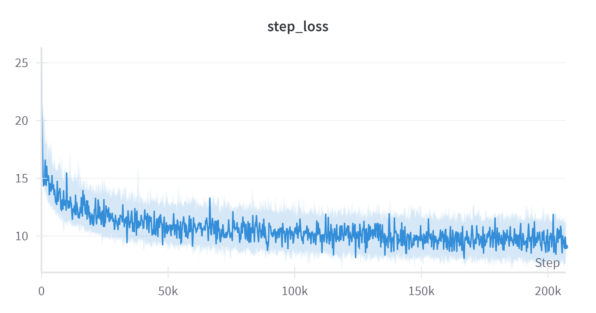
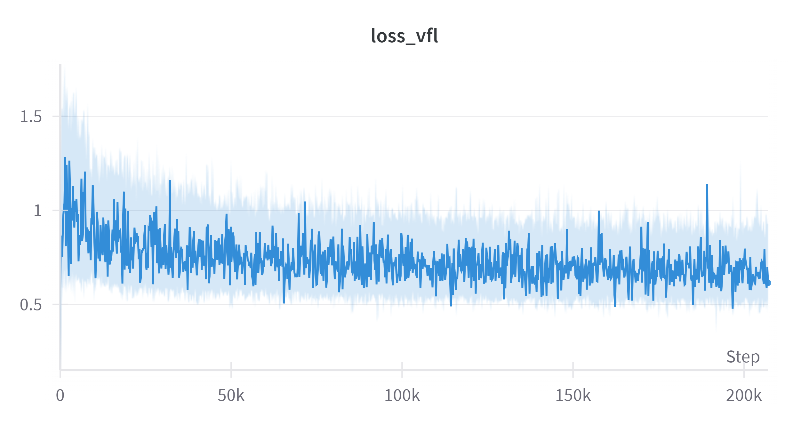
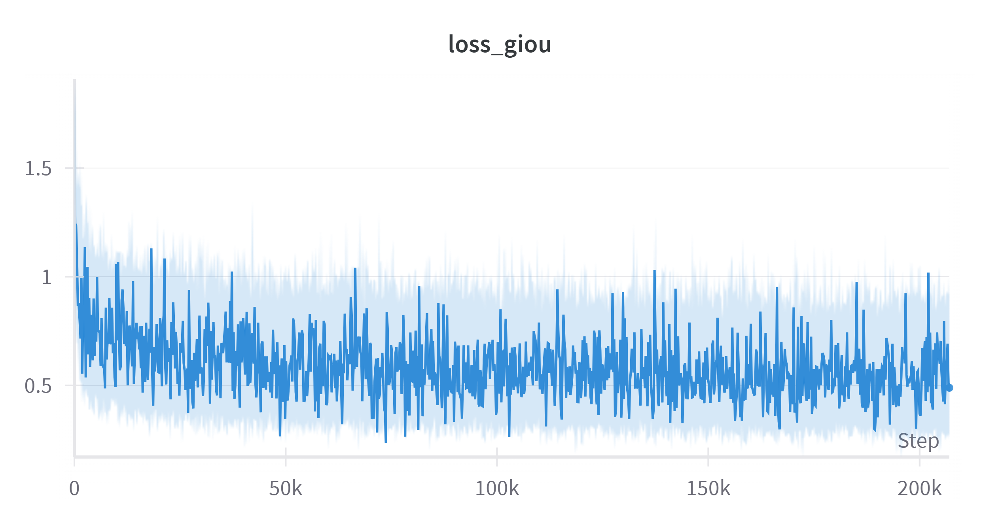
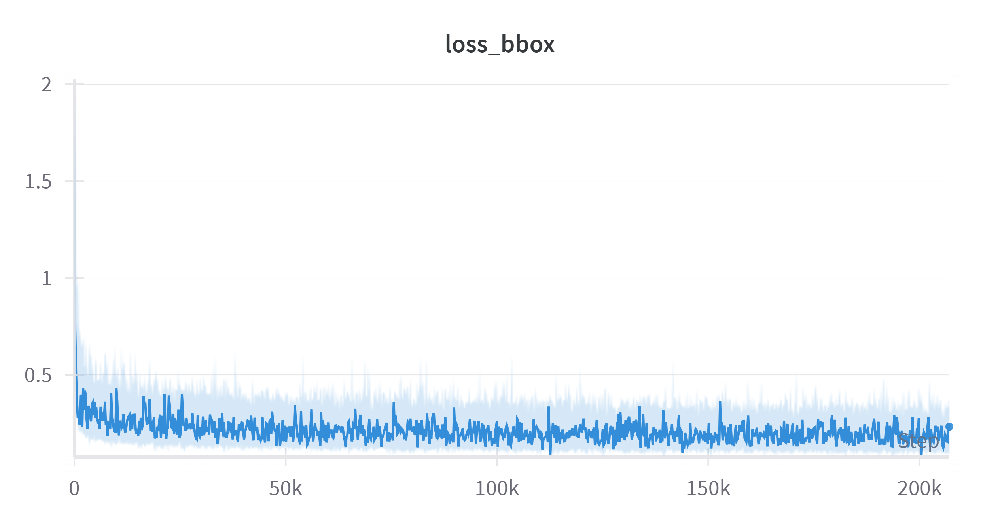

# RT-DETR-With-ROPE

**A version of RT-DETR with Rotary Positional Embedding (ROPE)**

## COCO Evaluation

Results are reported on the **COCO 2017 validation set (val2017)**. The following are metrics from the **best epoch (
Epoch 28)**:

| Metric | IoU Threshold | Area   | Max Detections | Value |
|--------|---------------|--------|----------------|-------|
| **AP** | 0.50:0.95     | all    | 100            | 0.659 |
| **AP** | 0.50          | all    | 100            | 0.851 |
| **AP** | 0.75          | all    | 100            | 0.710 |
| **AP** | 0.50:0.95     | small  | 100            | 0.479 |
| **AP** | 0.50:0.95     | medium | 100            | 0.689 |
| **AP** | 0.50:0.95     | large  | 100            | 0.812 |
| **AR** | 0.50:0.95     | all    | 1              | 0.468 |
| **AR** | 0.50:0.95     | all    | 10             | 0.646 |
| **AR** | 0.50:0.95     | all    | 100            | 0.733 |
| **AR** | 0.50:0.95     | small  | 100            | 0.650 |
| **AR** | 0.50:0.95     | medium | 100            | 0.719 |
| **AR** | 0.50:0.95     | large  | 100            | 0.837 |
| **AR** | 0.50          | all    | 100            | 0.900 |
| **AR** | 0.75          | all    | 100            | 0.813 |

---

## Graphs

![AP [0.5:0.95]](charts/apval.png)
![AP [0.5]](charts/ap0.5.png)





---

## Notes

* The model used is RT-DETR-S with a pretrained backbone.
* Model trained from scratch on COCO, using EMA and cosine learning rate scheduling.

---

## Citation

```
@misc{lv2023detrs,
      title={DETRs Beat YOLOs on Real-time Object Detection},
      author={Yian Zhao and Wenyu Lv and Shangliang Xu and Jinman Wei and Guanzhong Wang and Qingqing Dang and Yi Liu and Jie Chen},
      year={2023},
      eprint={2304.08069},
      archivePrefix={arXiv},
      primaryClass={cs.CV}
}

@misc{lv2024rtdetrv2improvedbaselinebagoffreebies,
      title={RT-DETRv2: Improved Baseline with Bag-of-Freebies for Real-Time Detection Transformer}, 
      author={Wenyu Lv and Yian Zhao and Qinyao Chang and Kui Huang and Guanzhong Wang and Yi Liu},
      year={2024},
      eprint={2407.17140},
      archivePrefix={arXiv},
      primaryClass={cs.CV},
      url={https://arxiv.org/abs/2407.17140}, 
}
```
